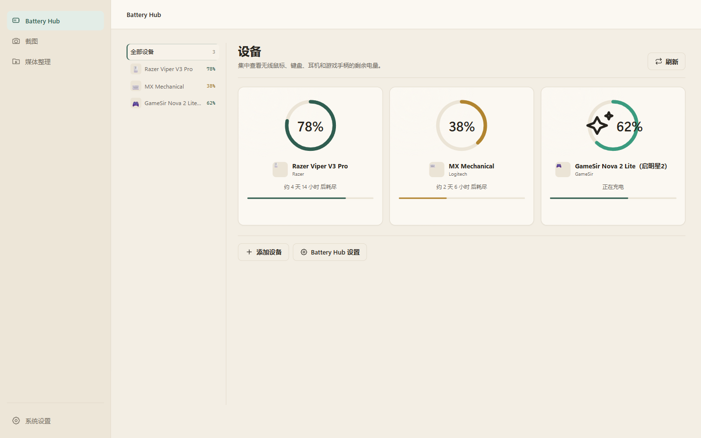
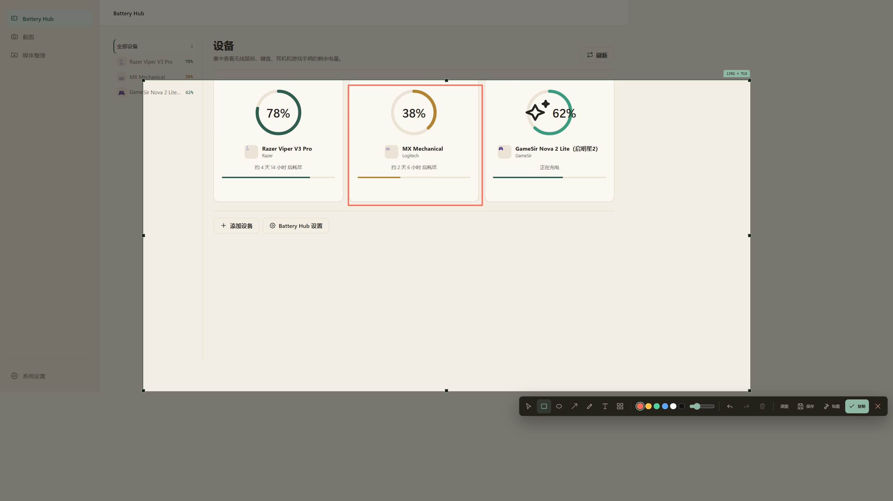
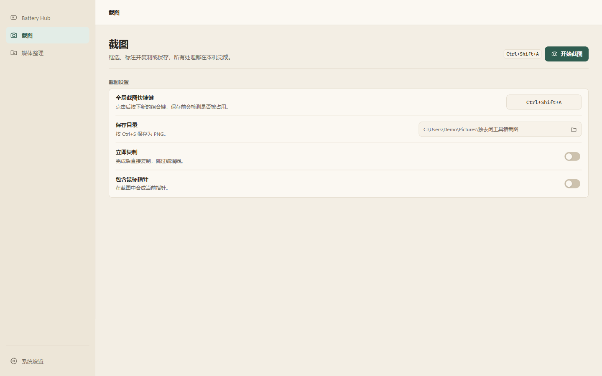
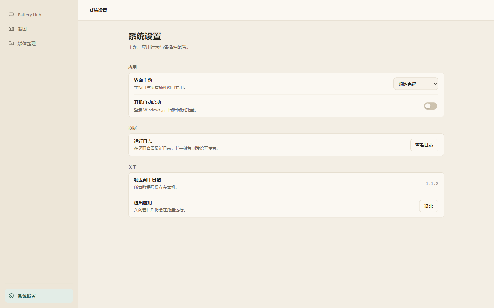

# 独去闲工具箱

Windows 10/11 · Electron + React + TypeScript · v1.1.3

本地工具箱，集中处理三件日常任务：截图标注、查看无线外设电量、按拍摄时间整理照片和视频。应用不要求账号，不上传文件，也不包含遥测。

<p align="center">
  
</p>

## 一眼看懂

主窗口左侧固定显示插件入口，右侧是当前功能页面。

| 入口 | 能做什么 | 典型入口 |
| --- | --- | --- |
| **Battery Hub** | 集中查看鼠标、键盘、耳机和手柄电量；查看历史、估算续航、设置提醒 | 左侧第一项，通常为默认首页 |
| **截图** | 冻结桌面、框选或选窗口，标注后复制、保存或贴图 | `Ctrl+Shift+A` |
| **媒体整理** | 预览照片和视频按年份及拍摄日期移动后的结果 | 左侧第三项 |
| **系统设置** | 修改主题、开机启动、运行日志及插件选项 | 左侧底部 |

## 界面预览

以下截图用于说明主要布局和操作入口。截图中的数据为示例，实际内容会随设备、窗口宽度和主题变化。

### Battery Hub

设备页把外设电量显示为独立卡片。侧栏保留设备快捷入口，卡片中的圆环、颜色和文字共同表示电量状态。


- 点击卡片进入详情页，可查看 24 小时或 7 天电量历史、耗电速度、预计可用时间和最后充电时间。
- “添加设备”会扫描已连接的 HID 设备；已支持设备可直接添加，未知设备可执行 30 秒报文扫描完成校准。
- 设备支持改名、更换 emoji 图标、隐藏、移除和手动排序。
- 低电量阈值可按设备单独设置；托盘只显示工具箱汇总状态，不为每个设备额外创建图标。
- 内置协议覆盖 JZ M7、GameSir 启明星2、罗技、雷蛇、PlayStation、SteelSeries、HyperX、Corsair、Audeze 等设备族。GameSir Nova 2 Lite 通过本机 HID 直接查询，不要求官方软件运行。

### 截图编辑器

按全局快捷键后，桌面会先冻结，再进入选区。完成框选后可缩放选区、添加标注并选择输出方式。



常用流程：

1. 按 `Ctrl+Shift+A` 开始截图。
2. 拖动框选区域；单击窗口选择窗口；双击当前显示器截取整屏。
3. 使用矩形、椭圆、箭头、画笔、文字或马赛克标注。
4. 选择复制成品、复制原图、保存 PNG 或创建置顶贴图。

选区阶段和编辑阶段都支持 `Esc` 取消。工具栏包含选择、撤销、重做、删除、颜色和粗细控制。鼠标指针默认不合成，可在截图设置中开启。

### 截图主页

截图主页集中显示开始截图入口和截图设置。



截图设置提供：

- 全局快捷键录制和占用检测
- PNG 保存目录选择
- 截图完成后立即复制
- 是否包含鼠标指针

### 系统设置

系统设置管理主题、开机启动和运行日志。运行日志可直接在界面查看并复制，不需要手工定位文件。



应用设置提供浅色、深色、跟随系统主题，以及登录 Windows 后自动启动到托盘。

## 快捷键

| 操作 | 快捷键 |
| --- | --- |
| 开始截图 | `Ctrl+Shift+A` |
| 复制标注成品 | `Ctrl+C` 或 `Enter` |
| 保存标注成品 | `Ctrl+S` |
| 复制原图 | `Ctrl+Shift+C` |
| 撤销标注 | `Ctrl+Z` |
| 重做标注 | `Ctrl+Shift+Z` |
| 放弃截图 | `Esc` |

托盘菜单还提供全屏截图和重复上次选区。

## 媒体整理

媒体整理不是图库。它读取源文件夹中的照片和视频，按拍摄时间生成移动计划：

1. 选择“待整理文件夹”和“输出文件夹”。
2. 点击“生成预览”，检查每项的目标年份和文件名。
3. 确认后执行移动。

执行前必须检查预览。确认操作会移动文件，并且不能撤销。

## 数据与隐私

| 数据 | 默认位置 |
| --- | --- |
| 截图成品 | `图片\独去闲工具箱截图` |
| 设置、贴图临时文件、未完成会话 | Electron 应用数据目录 |
| 运行日志 | Electron 应用数据目录下的 `logs\toolbox.log` |
| Battery Hub 数据 | Electron 应用数据目录下的 `battery-hub.json` |

截图、设置和电量数据只保存在本机，不上传，也不包含遥测。日志记录启动、插件、快捷键和截图流程异常，不记录截图图像、剪贴板内容或其他软件的窗口标题。

日志每个文件最多 2 MB，最多保留 5 个历史文件。“系统设置 > 诊断 > 运行日志”可查看最近 512 KB 日志并一键复制。Battery Hub 会记录电量读取、HID 原始电池报文、解码结果和读取失败。

首次启用电量模块时，只从原 Battery Hub 迁移设备配置，不迁移历史与模块设置。

## 运行与开发

要求 Node.js 20 或更高版本。依赖安装在项目内 `node_modules`。

```powershell
npm install
npm run dev
```

开发启动前会自动构建 Windows 蓝牙/Xbox 电量辅助程序。单独构建：

```powershell
npm run battery:build
```

生产预览：

```powershell
npm run build
npm start
```

验证与打包：

```powershell
npm run typecheck
npm test
npm run test:e2e
npm run package:dir
```

便携版输出到 `dist\win-unpacked`，运行其中的 `独去闲工具箱.exe`。当前产物未签名，也没有安装器或自动更新。

Electron 运行时必须保留整个 `win-unpacked` 文件夹，不能只复制 EXE。

## 架构

```text
React 渲染进程
  ↕ 受限 preload IPC
Electron 主进程
  ├─ 截图会话与冻结画面
  ├─ Battery Hub 电量轮询、历史与通知
  ├─ 独立 node-hid 工作进程和设备驱动
  ├─ HID 驱动：JZ M7、GameSir Nova 2 Lite、Logitech、Razer、Sony 等
  ├─ Windows 蓝牙与 Xbox 电量辅助程序
  ├─ 设置和文件写入
  ├─ 托盘、热键与剪贴板
  ├─ Koffi / Win32 窗口适配
  └─ 多贴图窗口
```

渲染进程启用 `contextIsolation` 和 sandbox，不开启 Node.js 集成。应用资源和媒体文件通过受控的 `toolbox://` 自定义协议读取，正式版不运行本地 HTTP 服务。

## 已知限制

- DRM 保护画面和部分独占全屏游戏可能无法捕获。
- 当前不支持滚动截图、OCR、录屏和截图搜索。
- 跨显示器与混合 DPI 已有坐标几何测试，但实机验收环境只有单显示器。
- 自定义系统光标开启后会合成可见指针，特殊光标样式可能回退为默认箭头。
- 部分第三方 Xbox 360 兼容接收器会被 Windows 识别为有线控制器，可能不提供标准电量。
- 未识别设备需要校准，仍有少数设备会隐藏或拒绝公开电量查询。

## 第三方来源

外设电量模块基于 [Battery Hub](https://github.com/battery-hub/battery-hub)，遵循 MIT 许可证。许可证和来源说明见 `THIRD_PARTY_NOTICES.md` 与 `licenses/`。
